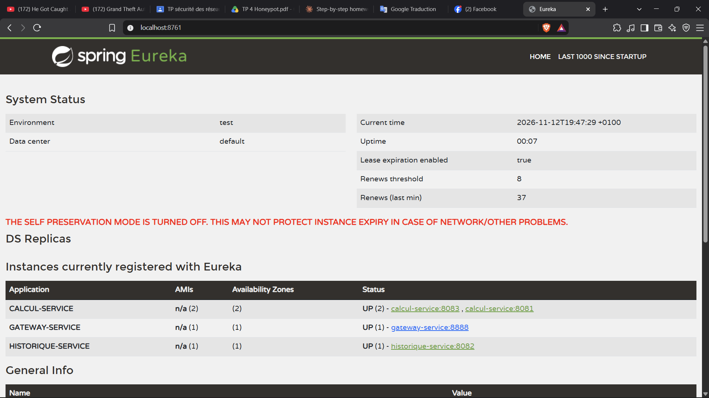
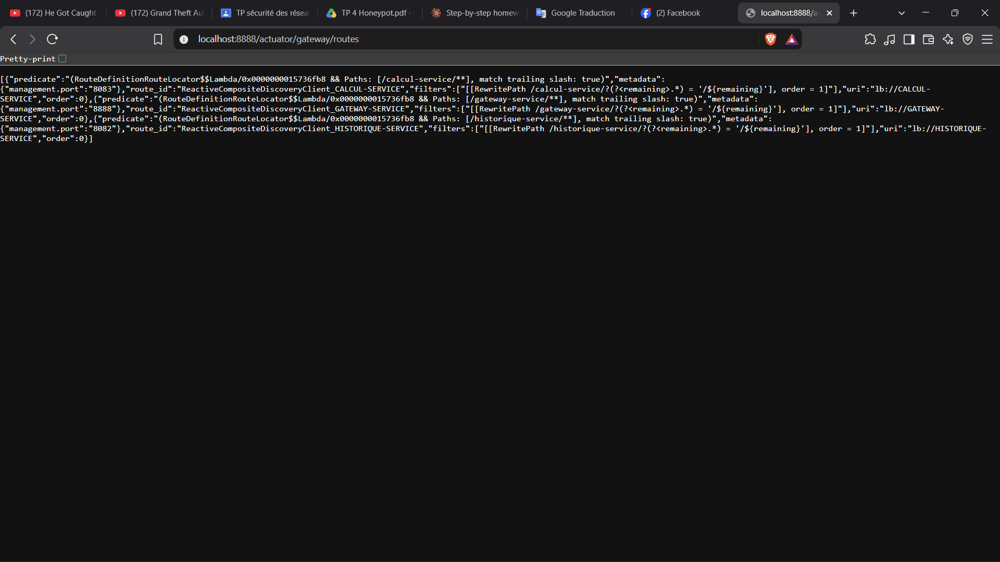
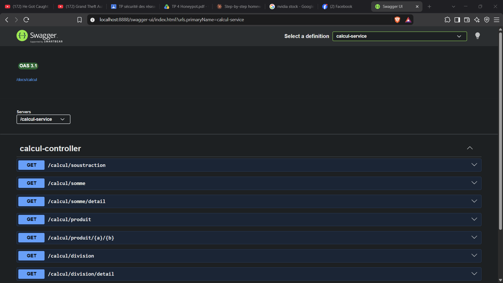
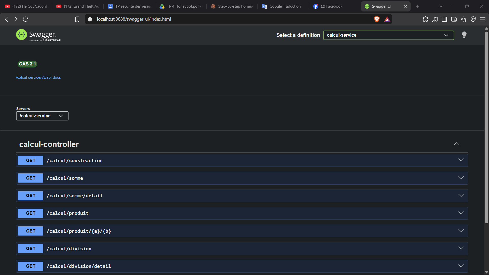
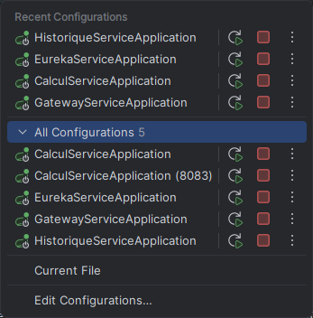

# TP4 - Spring Cloud : Eureka & Spring Cloud Gateway

---

## 1. Réponses aux Questions

### Partie A : Conception

#### Question A.4.1 : Découverte et correspondance nom / adresses
- **Composant :** Le serveur d'annuaire **Eureka Server** (`eureka-service`).
- **Mise à jour :**
  - À l'enregistrement initial au démarrage de chaque instance.
  - Périodiquement par les battements de cœur (*heartbeats*, toutes les 5s) et le rafraîchissement du registre client.
  - À la désinscription lors de l'arrêt ou après expiration du bail (*lease expiration*).

#### Question A.4.2 : Point d'entrée unique (Passerelle API)
- **Avantage :** Point de contact unique (`http://localhost:8888`), masquage de l'architecture interne et centralisation des fonctions transverses (sécurité, routage, CORS, documentation Swagger).
- **Inconvénient :** Point unique de défaillance potentiel (*Single Point of Failure*) et goulot d'étranglement / latence supplémentaire si non redondé.

#### Question A.4.3 : Équilibrage de charge (Round-Robin)
- **Répartition :** Chaque instance reçoit **3 requêtes**.
- **Perception client :** Non, le client ne s'en aperçoit pas car l'URL d'appel et la réponse retournée sont identiques.

---

### Partie B : L'Annuaire (`eureka-service`)

#### Question B.1 : Coexistence sur une même machine
Chaque microservice s'exécute dans une **JVM indépendante** et écoute sur un **port TCP distinct** (`8761`, `8081`, `8083`, `8082`, `8888`), évitant tout conflit de port.

---

### Partie C : Enregistrement dans l'Annuaire

#### Question C.1 : Nom de service vs Identifiant d'instance
- **Nom de service (`CALCUL-SERVICE`) :** Identifiant logique utilisé par les clients (Feign / Gateway) pour interroger Eureka et équilibrer la charge.
- **Identifiant d'instance (`calcul-service:8081`, `calcul-service:8083`) :** Clé unique pour Eureka permettant de gérer individuellement le cycle de vie et l'état de santé de chaque nœud.

#### Question C.2 : Lancement sans `--server.port=8083`
La seconde instance tenterait de se lier au port `8081` déjà utilisé, provoquant une erreur de démarrage `PortAlreadyInUseException` / `BindException: Address already in use`.

---

### Partie D : Client Déclaratif OpenFeign & Équilibrage de Charge

#### Question D.1 : Stratégie de répartition de charge
- **Traces observées :** Alternance systématique entre `[calcul-service:8081]` et `[calcul-service:8083]`.
- **Règle & Nom :** Sélection circulaire successive : stratégie du **Round-Robin** (tour de rôle) gérée par Spring Cloud LoadBalancer.

#### Question D.2 : Nom de service erroné dans Feign (`CALCUL-SERVIC`)
- **Statut obtenu :** `503 Service Unavailable`.
- **Bloc catch déclenché :** `catch (FeignException e)` dans `OperationController` car aucune instance n'est trouvée pour ce nom.

---

### Partie E : Passerelle Spring Cloud Gateway

#### Question E.1 : En-tête `Location` et en-têtes `X-Forwarded-*`
La passerelle transmet les en-têtes `X-Forwarded-Host: localhost:8888` et `X-Forwarded-Port: 8888`. Grâce à `server.forward-headers-strategy=framework`, `historique-service` génère l'en-tête `Location` avec le port public `8888`.

#### Question E.2 : Routage statique (E.3) vs dynamique (E.5)
- **Statique :** URL personnalisées et indépendantes des noms internes, mais **nécessite de modifier la passerelle** lors de l'ajout d'un service.
- **Dynamique :** Zéro configuration lors de l'ajout d'un service (découverte automatique via Eureka), mais impose le nom du service dans l'URI.

#### Question E.3 : Auto-routage de la passerelle vers elle-même
En mode dynamique, Eureka fournit toutes les instances enregistrées, y compris `GATEWAY-SERVICE`. La passerelle génère donc automatiquement une route vers `lb://GATEWAY-SERVICE`. Cela n'est pas gênant et permet d'accéder aux endpoints Actuator via ce préfixe.

---

### Questions de Synthèse

#### 1. Tableau comparatif TP3 vs TP4
| Aspect | TP3 | TP4 (Spring Cloud) | Étape d'Observation |
|---|---|---|---|
| **Nombre de programmes** | 2 microservices | 2 microservices + 1 annuaire + 1 passerelle + 1 réplica | B.5, C.5, E.2 |
| **Dépendances Maven** | `spring-boot-starter-web` | Starters Spring Cloud gérés par BOM | A.2, B.1, C.0, D.1, E.1 |
| **Adresse d'un service** | URL en dur (`localhost:8081`) | Résolution dynamique par nom via Eureka | C.5, D.1, E.5 |
| **Appel entre services** | `RestClient` / `RestTemplate` | Interface `@FeignClient` | D.1, D.2 |
| **Gestion des erreurs** | `HttpClientErrorException` | `FeignException` | D.2, D.4 |
| **Point d'entrée client** | Multiples ports (`8081`, `8082`) | Port unique `8888` | E.2, E.5 |
| **Multiples instances** | Inutilisées | Équilibrage Round-Robin (LoadBalancer) | C.5, D.4, E.3 |
| **Serveur embarqué** | Tomcat partout | Tomcat (métier) / Netty (passerelle réactive) | B.5, E.2 |
| **Tolérance aux pannes** | Échec immédiat | Bascule automatique sur instances saines | C.6 |
| **Organisation code** | Projets séparés | Multi-modules Maven | B.0 |
| **Documentation / Test** | Postman / curl | Swagger UI par service et agrégé sur passerelle | C.4, D.4, E.2, E.5 |
| **Classes de données** | Getters / Setters manuels | Annotations Lombok | C.1, C.7 |

#### 2. Trajet d'une requête de création d'opération
`POST http://localhost:8888/historique-service/operations` avec `{"operateur":"somme","a":1,"b":2}` :
1. **Client $\rightarrow$ Passerelle (8888) :** Route détectée `/historique-service/**`, résolution d'`HISTORIQUE-SERVICE` via Eureka.
2. **Passerelle $\rightarrow$ `historique-service` (8082) :** Requête transmise sur `/operations` avec en-têtes `X-Forwarded-*`.
3. **`historique-service` $\rightarrow$ `calcul-service` (8081/8083) :** Feign interroge LoadBalancer qui choisit une instance (Round-Robin) et exécute `somme(1, 2)`.
4. **`calcul-service` :** Calcule `1+2=3`, affiche la trace console et renvoie `3.0`.
5. **`historique-service` :** Enregistre l'opération, construit `Location: http://localhost:8888/historique-service/operations/1` et renvoie `201 Created`.
6. **Passerelle $\rightarrow$ Client :** Réponse HTTP 201 retransmise au client.

#### 3. Programmes intégrant Spring Cloud LoadBalancer
- **`historique-service`** (pour les appels Feign vers `CALCUL-SERVICE`).
- **`gateway-service`** (pour le routage `lb://`).

#### 4. Analyse des starters dans les `pom.xml`
- `eureka-client` : Présent dans `calcul-service`, `historique-service`, `gateway-service` (enregistrement / découverte).
- `openfeign` : Présent uniquement dans `historique-service` (client HTTP déclaratif).
- `gateway-server-webflux` : Présent uniquement dans `gateway-service` (moteur réactif de la passerelle).

#### 5. Problème de l'adresse en dur et solution
- **Problème :** Couplage fort à une IP/port fixe, impossibilité de mise à l'échelle dynamique ou de bascule en cas de panne.
- **Solution :** Annuaire Eureka (enregistrement logique) + OpenFeign / LoadBalancer (résolution et répartition automatique).

#### 6. Gestion d'état en mémoire et multi-instances
- **Conséquence :** Données désynchronisées entre les instances (non-respect du principe *stateless*).
- **Correction :** Déporter la persistance vers une base de données partagée (ex: PostgreSQL) ou un cache distribué (Redis).

#### 7. Rôle de `@EnableDiscoveryClient`
Active la découverte de services Eureka Client dans l'application. Bien qu'automatique dans les versions récentes de Spring Cloud dès que le starter est présent dans le classpath, elle permet d'expliciter le rôle du composant.

#### 8. Rôle de `@GetMapping` : Contrôleur vs Interface Feign
- **Contrôleur (`CalculController`) :** Déclare une route HTTP entrante gérée par Spring MVC.
- **Client Feign (`CalculClient`) :** Définit le modèle de la requête HTTP sortante générée automatiquement.

#### 9. Indépendance dans un projet multi-modules
Chaque module produit son propre JAR exécutable, tourne dans sa propre JVM sur son propre port, et possède un cycle de vie totalement indépendant.

#### 10. Origine de l'adresse dans la zone *Servers* de Swagger UI
Transmise par la passerelle via les en-têtes `X-Forwarded-*` et interprétée par `server.forward-headers-strategy=framework`.

#### 11. Fonctionnement de Lombok et exclusion du JAR
Lombok injecte le bytecode à la compilation (`javac`). Le code compilé contient déjà les méthodes, rendant la bibliothèque inutile à l'exécution (`<optional>true</optional>`).

---

## 2. Tableaux de Tests

### Étape D.4 : Tests directs sur `historique-service` (Port 8082)

| N° | Requête envoyée | Statut & Corps obtenus | Trace console instance |
|:--:|---|---|---|
| **1** | `POST /operations` `{"operateur":"somme","a":8,"b":2}` | **201 Created** `{"id":1,"operateur":"somme","a":8,"b":2,"resultat":10.0}` `Location: http://localhost:8082/operations/1` | `[calcul-service:8081] somme 8+2` |
| **2** | `POST /operations` `{"operateur":"produit","a":6,"b":7}` | **201 Created** `{"id":2,"operateur":"produit","a":6,"b":7,"resultat":42.0}` `Location: http://localhost:8082/operations/2` | `[calcul-service:8083] produit 6*7` |
| **3** | `POST /operations` `{"operateur":"division","a":7,"b":2}` | **201 Created** `{"id":3,"operateur":"division","a":7,"b":2,"resultat":3.5}` `Location: http://localhost:8082/operations/3` | `[calcul-service:8081] division 7/2` |
| **4** | `POST /operations` `{"operateur":"division","a":7,"b":0}` | **400 Bad Request** `{"erreur":"Erreur : division par 0 impossible"}` | `[calcul-service:8083] division 7/0` |
| **5** | `POST /operations` `{"operateur":"racine","a":9,"b":0}` | **400 Bad Request** `{"erreur":"Operateur inconnu : racine"}` | *(Aucune trace)* |
| **6** | `GET /operations` | **200 OK** Tableau JSON des opérations 1, 2 et 3 | *(Aucune trace)* |
| **7** | `GET /operations/2` | **200 OK** `{"id":2,"operateur":"produit","a":6,"b":7,"resultat":42.0}` | *(Aucune trace)* |

---

### Étape E.2 : Tests via Passerelle en Routage Statique (Port 8888)

| N° | Requête envoyée | Statut & Corps obtenus | Instance ayant répondu / tracé |
|:--:|---|---|---|
| **1** | `GET /calcul/somme?a=2&b=3` | **200 OK** `5` | `[calcul-service:8081]` |
| **2** | `GET /calcul/division?a=7&b=0` | **400 Bad Request** `Erreur : division par 0 impossible` | `[calcul-service:8081]` |
| **3** | `GET /operations` | **200 OK** Tableau JSON des opérations | `historique-service:8082` |
| **4** | `POST /operations` `{"operateur":"soustraction","a":10,"b":4}` | **201 Created** `{"id":4,"operateur":"soustraction","a":10,"b":4,"resultat":6.0}` `Location: http://localhost:8888/operations/4` | `historique-service` $\rightarrow$ `[calcul-service:8081]` |
| **5** | `GET /calcul/somme/detail?a=2&b=3` | **200 OK** `{"operation":"somme","a":2,"b":3,"resultat":5.0}` | `[calcul-service:8081]` |
| **6** | `GET /bonjour` | **404 Not Found** Corps JSON d'erreur passerelle | Passerelle (aucune route) |

---

### Étape E.5 : Tests via Passerelle en Routage Dynamique (Port 8888)

| N° | Requête envoyée | Statut & Corps obtenus | Instance ayant répondu / tracé |
|:--:|---|---|---|
| **1** | `GET /calcul-service/calcul/somme?a=2&b=3` | **200 OK** `5` | `[calcul-service:8081]` ou `:8083` |
| **2** | `GET /calcul-service/calcul/produit/6/7` | **200 OK** `42` | `[calcul-service:8081]` ou `:8083` |
| **3** | `GET /historique-service/operations` | **200 OK** Tableau JSON des opérations | `historique-service:8082` |
| **4** | `POST /historique-service/operations` `{"operateur":"division","a":8,"b":4}` | **201 Created** `{"id":5,"operateur":"division","a":8,"b":4,"resultat":2.0}` `Location: http://localhost:8888/historique-service/operations/5` | `historique-service` $\rightarrow$ `calcul-service` |
| **5** | `GET /calcul/somme?a=2&b=3` | **404 Not Found** Corps JSON d'erreur passerelle | Passerelle (pas de route sans préfixe) |
| **6** | `GET /gateway-service/actuator/gateway/routes` | **200 OK** Tableau JSON des routes dynamiques | `gateway-service:8888` |

---

## 3. Captures d'Écran Requises

### 1. Tableau de bord Eureka
- **URL :** `http://localhost:8761`
- **Description :** Capture montrant les trois services (`CALCUL-SERVICE`, `HISTORIQUE-SERVICE`, `GATEWAY-SERVICE`), avec `CALCUL-SERVICE` ayant deux instances (ports 8081 et 8083).

---

### 2. Routes Actuator dynamiques
- **URL :** `http://localhost:8888/actuator/gateway/routes`
- **Description :** Capture montrant la liste JSON des routes en configuration dynamique (`CALCUL-SERVICE`, `HISTORIQUE-SERVICE`, `GATEWAY-SERVICE`).

---

### 3. Swagger UI Passerelle - Configuration statique (E.2)
- **URL :** `http://localhost:8888/swagger-ui.html`
- **Description :** Capture montrant la liste *Select a definition* et la zone *Servers* en configuration statique (E.2).

---

### 4. Swagger UI Passerelle - Configuration dynamique (E.5)
- **URL :** `http://localhost:8888/swagger-ui.html`
- **Description :** Capture montrant la liste *Select a definition* et la zone *Servers* en configuration dynamique (E.5).

---

### 5. Consoles des 5 instances
- **Description :** Capture d'écran des cinq consoles (ou de la fenêtre Services d'IntelliJ IDEA) montrant les lignes `started on port 8761, 8081, 8083, 8082 et 8888`.

